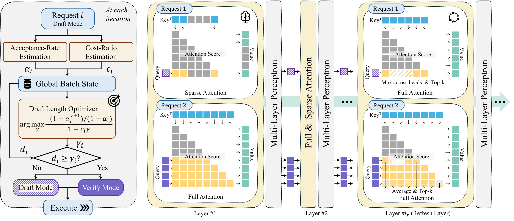

# ASPIRE

Source code for reproducing results from **ASPIRE: Asynchronous Batched Self-Speculative Decoding for
Long-Context LLM Inference**. See the [project page](https://amir-zsh.github.io/ASPIRE/).

ASPIRE speeds up batched long-context decoding with self-speculation. Unlike
prior batched methods, requests are not synchronized: each one drafts and
verifies on its own schedule inside a single batched forward pass, and the
verification is exact.

<p align="center"></p>

**Overview of ASPIRE.** The speculation scheduler (left) estimates a
per-request acceptance rate and cost ratio to pick each request's target draft
length, deciding whether it drafts or verifies at each step. The unified mixed
forward (middle) runs drafting requests (sparse attention over selected KV
pages) and verifying requests (full attention over the entire cache) together
in one batched pass. At a designated refresh layer (right), drafting requests
run full attention and re-select the top-scoring context pages, updating the
sparse context for the following layers and the next draft step.

## Installation

ASPIRE requires Python 3.11, CUDA, and an NVIDIA GPU. It was validated with
PyTorch 2.10.0 and CUDA 12.8 on H100 NVL 96GB GPUs.

```bash
uv venv --python 3.11
source .venv/bin/activate

uv pip install torch==2.10.0 --index-url https://download.pytorch.org/whl/cu128
uv pip install -r requirements.txt
bash scripts/install_flashinfer.sh
```

The FlashInfer installer applies the mixed-attention patch required by ASPIRE.
A stock FlashInfer installation does not provide the kernel used by the
benchmark.


## Prepare a model

ASPIRE follows the [gpt-fast](https://github.com/pytorch-labs/gpt-fast) model
preparation flow: download the Hugging Face checkpoint, then convert it to a
single `model.pth` file.

For example, prepare Qwen3-8B:

```bash
export HF_TOKEN="your_huggingface_token"

python scripts/download.py \
    --repo_id Qwen/Qwen3-8B \
    --hf_token "$HF_TOKEN" \
    --out_dir checkpoints/Qwen/Qwen3-8B

python scripts/convert_hf_checkpoint.py \
    --checkpoint_dir checkpoints/Qwen/Qwen3-8B
```

The converter creates:

```text
checkpoints/Qwen/Qwen3-8B/model.pth
```

Keep the tokenizer and configuration files in the same directory as
`model.pth`. The same process can be used for the other supported models:
`Qwen/Qwen3-1.7B` and `deepseek-ai/DeepSeek-R1-Distill-Llama-8B`. The
downloaded Hugging Face directory can also be passed to `--checkpoint`
directly; the two load paths produce identical outputs.

## Run a benchmark

All experiments use `benchmark.py`:

```bash
python benchmark.py \
    --model <model> \
    --checkpoint <path-to-model.pth> \
    --dataset <dataset> \
    --method <method> \
    --output-dir <output-directory>
```

For example, run the autoregressive baseline and fixed-draft ASPIRE on
LongBench:

```bash
python benchmark.py \
    --model qwen3-8b \
    --checkpoint checkpoints/Qwen/Qwen3-8B/model.pth \
    --dataset longbench \
    --method autoregressive \
    --output-dir results/qwen3-8b-longbench

python benchmark.py \
    --model qwen3-8b \
    --checkpoint checkpoints/Qwen/Qwen3-8B/model.pth \
    --dataset longbench \
    --method aspire-fixed \
    --output-dir results/qwen3-8b-longbench
```

Available methods are:

- `autoregressive`: autoregressive decoding baseline
- `aspire-fixed`: ASPIRE with a fixed draft length
- `aspire-fsm`: ASPIRE with the feedback scheduler
- `aspire`: ASPIRE with the latency-aware scheduler

## Run the latency-aware scheduler

The latency-aware scheduler requires calibration. To reproduce the results calibrate on data collected from the same task,
GPU, batch size, and tensor-parallel configuration. First run `aspire-fsm` and
fit the timing model:

```bash
python benchmark.py \
    --model qwen3-8b \
    --checkpoint checkpoints/Qwen/Qwen3-8B/model.pth \
    --dataset longbench \
    --method aspire-fsm \
    --fit-calibration results/qwen3-8b-longbench/calibration.json \
    --output-dir results/qwen3-8b-longbench
```

Then pass the calibration to ASPIRE:

```bash
python benchmark.py \
    --model qwen3-8b \
    --checkpoint checkpoints/Qwen/Qwen3-8B/model.pth \
    --dataset longbench \
    --method aspire \
    --calibration results/qwen3-8b-longbench/calibration.json \
    --output-dir results/qwen3-8b-longbench
```

## Multi-GPU execution

Use `torchrun` and set `--tp-size` to the number of GPUs. For two-way tensor
parallelism:

```bash
torchrun --standalone --nproc_per_node=2 benchmark.py \
    --tp-size 2 \
    --model qwen3-8b \
    --checkpoint checkpoints/Qwen/Qwen3-8B/model.pth \
    --dataset longbench \
    --method aspire-fixed \
    --output-dir results/qwen3-8b-longbench-tp2
```

## Models, datasets, and options

The supplied short model names are `qwen3-1.7b`, `qwen3-8b`, and
`ds-llama-8b`. They select the matching model identity and, per dataset, the
batch size measured on one H100 NVL 96GB at TP=1; requests are then replayed
cyclically until the decoding throughput converges. On GPUs with less memory,
lower `--max-batch-size`.

Supported datasets are `aime25`, `codeelo`, `longbench`,
`longbench_v2_30k`, `longbench_v2_80k`, and `synthetic`. Dataset revisions and
the default prompt and generation lengths are pinned by the benchmark driver.
Datasets are downloaded automatically on first use.

Every default can be overridden. Run the following command for the complete
list of options:

```bash
python benchmark.py --help
```

## Results

Each run writes one JSON file per repetition:

```text
results/qwen3-8b-longbench/
├── autoregressive-rep00.json
├── aspire-fixed-rep00.json
├── aspire-fsm-rep00.json
└── aspire-rep00.json
```

Each file records the resolved configuration, dataset metadata, per-step
timings, decoding metrics, generated-token counts, and a hash of the output
tokens.

## Credits

ASPIRE builds on [MagicDec](https://github.com/Infini-AI-Lab/MagicDec) (decoding
runtime, paged KV cache, self-speculative draft-and-verify) and
[SparseSpec](https://github.com/sspec-project/SparseSpec) (persistent batched
FlashInfer attention kernel), both Apache-2.0, and on
[gpt-fast](https://github.com/pytorch-labs/gpt-fast) (model definitions,
checkpoint conversion, tensor parallelism), BSD 3-Clause. See `NOTICE` and
`LICENSES/`.

## Citation

```bibtex
@article{ziashahabi2026aspire,
  title={ASPIRE: Asynchronous Batched Self-Speculative Decoding for Long-Context LLM Inference},
  author={Ziashahabi, Amir and Entezari Zarch, Hossein and Gao, Lei and Annavaram, Murali and Avestimehr, Salman},
  journal={arXiv preprint arXiv:XXXX.XXXXX},
  year={2026}
}
```

ASPIRE is released under Apache-2.0. See `LICENSE` and `NOTICE`.
